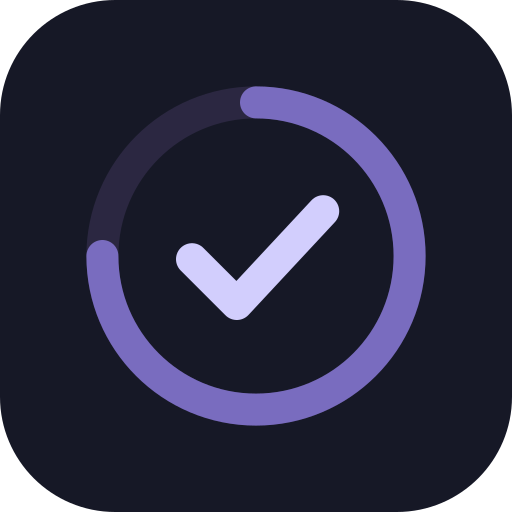
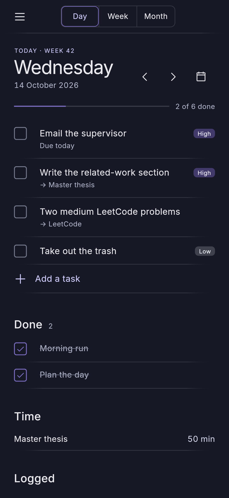
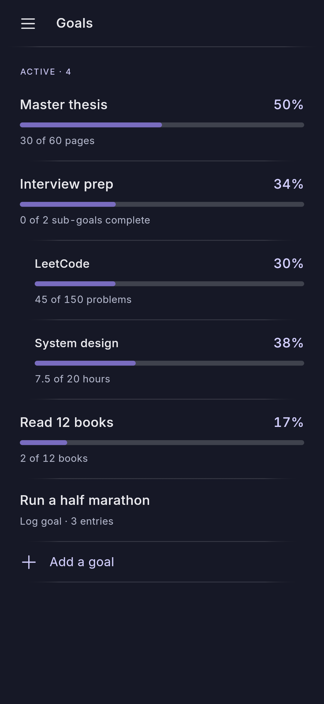
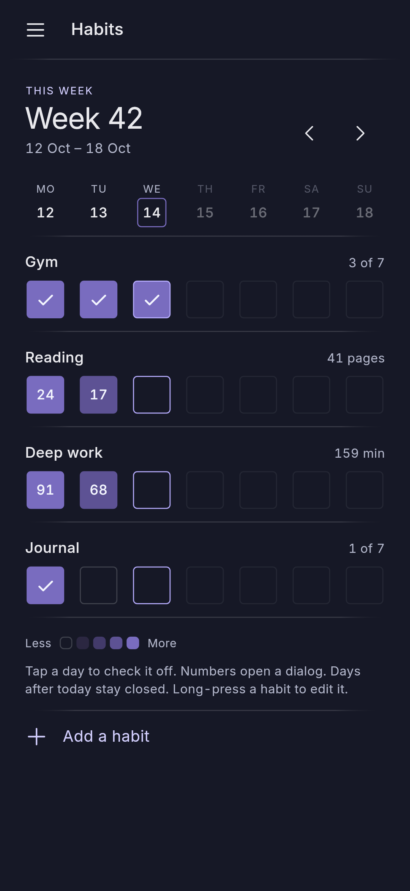
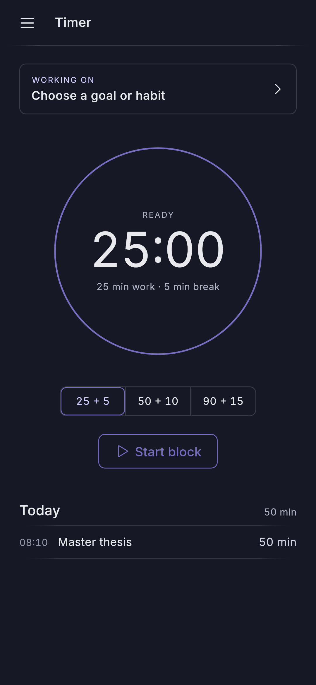

<h1 align="center">Time Manager</h1>

<p align="center">
  
</p>

An app that helps you reach your goals by organizing and tracking your time.
Simple and easy to use, with to-do lists, goals, habits and a focus timer, on
both Android and Linux.

Everything is stored as Markdown files with YAML frontmatter in a folder you
choose, so Syncthing can sync it between devices and Obsidian can read it. It
needs no account and works offline.

## Screenshots

<p align="center">
  
  
  
  
</p>

## Main Features

1. **Daily, weekly and monthly to-do lists**
    - Plan the next day/week/month with the to-do list
    - Track what you did and transfer the things you didn't to the next day/week/month (or simply discard)
    - Journal for daily/weekly/monthly reviews or simple additional notes
    - Recurring tasks, deadlines and reminders
2. **Measurable goals with sub-goals and derived progress**
    - Make and define a goal or a subgoal
    - Track them with visual progress bars
3. **Habits on a weekly heat-map grid**
    - Define habits and track them with a simple heatmap grid
4. **A Pomodoro timer that logs time to goals and habits**
    - Choose a goal/subgoal/habit to work on and log progress after the session
    - Track time spent on different goals

## Installing

**Android (7.0 or newer):** download `time-manager.apk` from the
[latest release](https://github.com/Koc13/TimeManager/releases/latest) and
open it on your phone. The first time, Android asks you to allow installing
apps from your browser or file manager.

On first start, pick (or create) the folder that should hold your data. To
sync it with other devices, choose a folder that Syncthing shares.

**Linux:** build from source (below) for now.

## Building from source

Needs Flutter 3.47 (stable). Run the following commands in the terminal:

```sh
git clone https://github.com/Koc13/TimeManager.git
```

Then navigate to the repository you just cloned and run:

```sh
flutter pub get
flutter test
flutter run -d linux          # or an Android device id
flutter build apk --release   # Android
flutter build linux --release # Linux bundle in build/linux/x64/release/bundle
```
